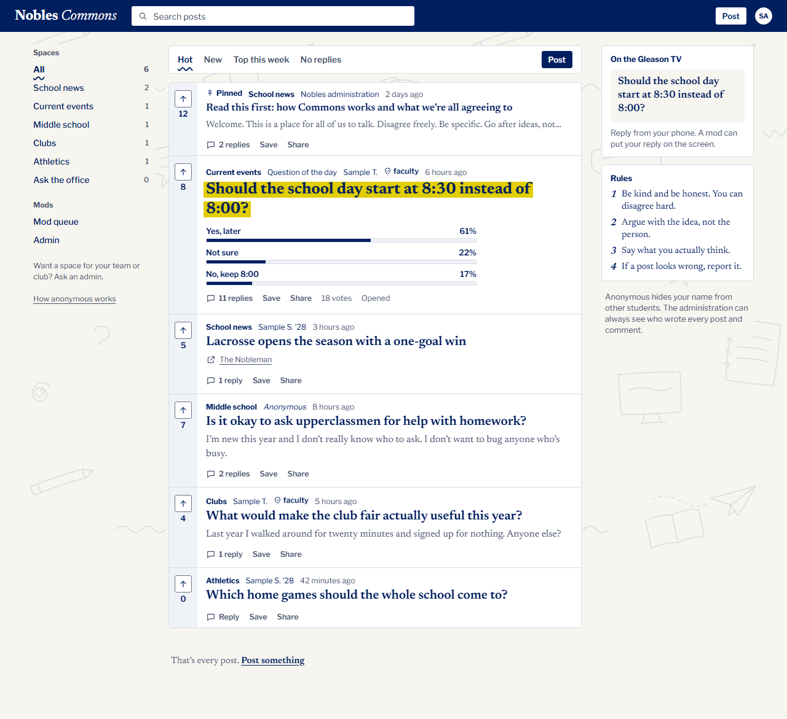
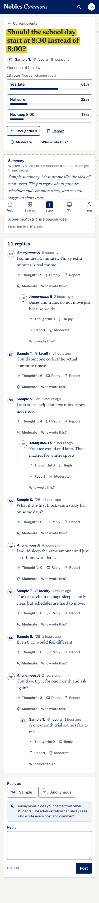
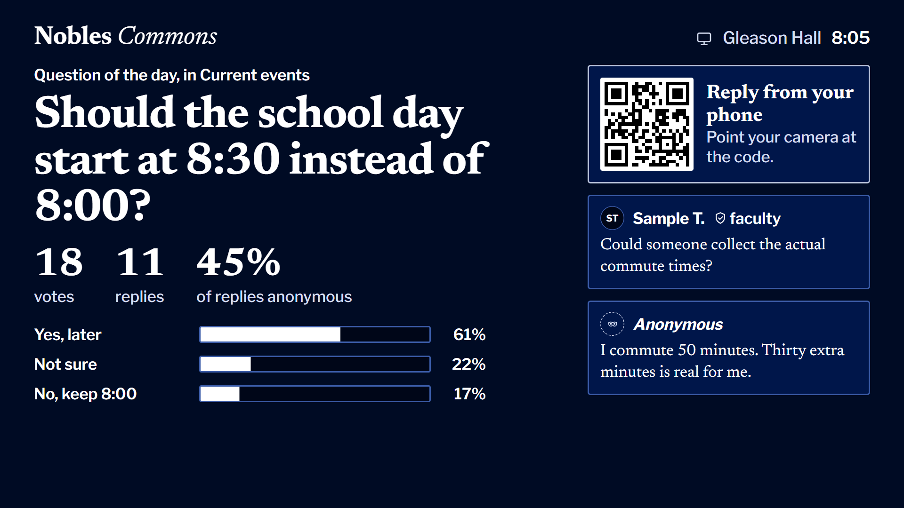

# Nobles Commons

A discussion board for the Noble and Greenough School community. Students and faculty sign in with their school Google account and talk in spaces for school news, current events, clubs, athletics and the middle school. The TV in Gleason Hall shows the question of the day.

Two ideas shape everything:

- **Kind and honest, both.** Disagree freely, about ideas and not people.
- **Anonymous by choice, and honest about what that means.** Anonymous hides your name from other students. The administration can always see who wrote every post and comment, and each time they look it is logged.

> **Deployed, not launched.** The site is live at https://nobles-reddit.web.app, but it is not open to students yet: Google sign-in still has to be switched on in the Firebase console, and `docs/PRIVACY.md` and `docs/SAFETY.md` are drafts for the school to review before any student uses it. See `docs/LAUNCH.md`.

## The site



### Layout

Navy type on off-white paper, with thin hand-drawn doodles (a pencil, a paper plane, the Gleason TV, a coffee cup) faint in the margins and behind the columns. Headlines and post text are set in Newsreader, a serif; labels and buttons are in Libre Franklin. Yellow is the one accent: it marks the question of the day and the focus ring in the dark theme. The active tab or space gets a wavy underline. There is no logo; the wordmark is plain type.

**On a desktop** (900px and wider) every page has three columns:

- **Left:** the spaces, with a post count for each. Moderators and admins also see links to the mod queue and the admin page.
- **Middle:** the feed comes first. A sort bar (Hot, New, Top this week, No replies) with a Post button, then the posts. Rows are not all the same: a pinned post is short and tight, the question of the day gets a big highlighted title and its poll, and a post with no text is just its title.
- **Right:** the space's description when you are in one, what is on the Gleason TV, the rules, a line about who can see anonymous posts, and Nobleman headlines once there is a feed for them.

**The feed** loads the next 20 posts as you get near the bottom. It is real pagination over the posts (a Firestore cursor), and the page count goes into the address as `?page=3`, so a refresh or a shared link opens with the same posts loaded and the scroll position put back. When the posts run out it says so and links to the post form. Nothing is ever repeated or made up to fill space.

**On a phone** the side columns go away. Spaces become a scrolling row across the top, posts become cards, and a tab bar along the bottom gives Feed, Spaces, Post, TV and You. Every button and link is at least 40px tall.

**On the Gleason Hall TV** (`/board`), a full-screen display shows the question of the day in large type, the poll results as bars, the vote and reply counts and what share of replies are anonymous, the replies a mod picked for the screen, and a QR code. It needs no login and reconnects by itself.

**Themes:** light by default, dark when the device asks for it or the person picks it, and a high-contrast theme for the TV.

<p>
  
  
</p>

More screenshots, at phone, tablet and desktop sizes, are in [`docs/screens`](docs/screens).

### Pages

| Address | Who | What it is |
| --- | --- | --- |
| `/sign-in` | Anyone | One button: sign in with a Nobles Google account. Other accounts are turned away with a kind message |
| `/onboarding` | New members | Name as it will show (first name and last initial), class year, part of the school, the ground rules, and an "I understand" box |
| `/` | Members | The feed: posts from every space |
| `/s/:slug` | Members | One space, with its description |
| `/t/:id` | Members | A post: its poll or link, the summary if there is one, the replies and a reply box |
| `/new` | Members | Write a post: text, a link or a poll |
| `/search` | Members | Search posts by their words |
| `/spaces` | Members | Every space as a tile (the phone's Spaces tab) |
| `/me` | Members | Your account, your posts (including anonymous ones), theme, saved threads, download your data, delete your account |
| `/about` | Anyone | How anonymous posting works and what it can’t hide, the rules, what gets stored |
| `/mod` | Moderators | The mod queue, reports and the question of the day |
| `/admin` | Administrators | Roles, spaces, question approvals, author lookup, AI budget, settings |
| `/admin/audit` | Administrators | The audit log |
| `/board` | Anyone | The Gleason Hall TV |

### What people can do

**Everyone signed in**

- Start a thread in a space as text, a link or a poll (2 to 6 options), and comment or reply up to four levels deep.
- Choose, every single time, whether to post under their name or as Anonymous. Nothing is preselected, and the composer always says plainly that the administration can see who wrote everything.
- Mark posts and comments "Thoughtful". It is the only reaction: there are no downvotes and no negative scores.
- Vote in polls, and change their vote.
- Sort the feed by Hot, New, Top this week or No replies, and search by the words in a post.
- Use a small amount of formatting: paragraphs, *italic*, **bold** and https links. Anything that looks like HTML is shown as plain text.
- Edit for 10 minutes after posting, and delete their own posts at any time.
- Save threads on their device, share links, and see which threads they have already opened.
- Report anything to a moderator, including "I am worried about someone's safety".
- Download everything the site holds about them, or delete their account.

**Anonymity**

- Other students and faculty see an anonymous author only as "Anonymous" with a mask icon and a dashed ring. Within one thread each anonymous person keeps the same letter ("Anonymous B") so a conversation can be followed; in another thread the letters start again.
- A faculty member posting anonymously is just "Anonymous", with no faculty tag.
- Nothing about an anonymous author reaches another student's browser: not in the page, the data, search, ids, timestamps or error messages. Tests check this.
- The administration can always find out who wrote something, but only by giving a reason, and every lookup is written to a log nobody can edit. Moderators cannot see authors at all.

**Moderators**

- Work through one queue, most urgent first: wellbeing flags, posts the automatic check held back, and reports.
- Hold, remove, restore or pin posts and comments, with a note that goes into the audit log.
- Approve the question of the day and choose which replies appear on the Gleason TV.

**Administrators**

- Everything moderators can do, plus give people roles, add and edit spaces, look up an author (with a reason, logged), read and export the audit log, watch the daily AI budget, and edit settings such as topics the question of the day should avoid and the resources shown to a student after a wellbeing flag.

**Computer-written help** (all labelled in plain words)

- **A safety check on every new post and comment.** Most posts go up after a few seconds. Possible harassment, hate, sexual content or personal information is held for a moderator. Possible self-harm or harm to others is never published and never deleted: it goes to the top of the queue, the school's wellbeing contact is emailed, and the author sees a caring message with places to get help.
- **Auto-summaries** of threads with 10 or more comments, labelled "Written by a computer model, not a person. It can get things wrong." The model is never told who wrote anything.
- **Question-of-the-day suggestions** every school morning. Nothing is published until a moderator approves one.
- A daily budget caps the cost. When it runs out, or the model is unavailable, the AI features say so and everything else keeps working.

**Accessibility**

- Every page works with a keyboard alone, with a visible focus ring and a skip link.
- Colour is never the only signal: anonymous posts also say "Anonymous", staff have a "faculty" tag, pinned posts say "Pinned".
- Every route passes automated accessibility checks (axe) in both themes, and Lighthouse checks the front page, a post and the TV screen.

**Privacy**

- The site collects a name, school email, class year and role, and nothing else: no photos, no ads, no trackers, no outside analytics, no uploads. Fonts are served from the site itself.

## What is in here

| Folder | What it is |
| --- | --- |
| `apps/web` | The website: Vite, React 18, TypeScript, plain CSS |
| `functions` | Cloud Functions (2nd gen). Every write goes through one of these |
| `packages/shared` | Types, input checks, limits and the hot-score formula, shared by both |
| `firestore.rules` | Who can read what. No client can write anything |
| `tests`, `e2e` | Rules tests, function tests and browser tests |
| `ml` | A skeleton for the hand-built summariser (a learning project, left unwritten on purpose) |
| `docs` | Architecture, deployment, a guide for the school, safety, privacy, AI, decisions, launch |
| `scripts` | Seeding, secret scan, deploy, smoke test, Lighthouse |

## Run it locally in 5 commands

You need Node 22.12 or newer and Java 21 or newer (for the Firebase emulators).

```bash
npm install
```

```bash
npx playwright install chromium
```

```bash
npm run dev
```

In a second terminal, once the emulators say they are ready:

```bash
npm run seed
```

Then open http://127.0.0.1:5173 and type an address into the "Emulator" box on the sign-in page. `sample.student@nobles.edu`, `sample.teacher@nobles.edu`, `sample.moderator@nobles.edu` and `sample.admin@nobles.edu` get roles from the seed; any other address is a student. That box only exists in emulator builds.

To run the tests, stop the dev servers first (Ctrl+C in the first terminal: the tests start their own emulators on the same ports), then:

```bash
npm test
```

Nothing here touches a real Firebase project: the emulators use the made-up project id `demo-nobles-commons` and the fake values in `.env.emulator`.

## Tests

| Command | What it runs |
| --- | --- |
| `npm run lint` | ESLint and Prettier |
| `npm run typecheck` | TypeScript, strict, in every package |
| `npm run test:unit` | Hot score, input checks, safe text formatter, rate limiter, AI prompt building and output checks |
| `npm run test:rules` | Firestore rules against the emulator |
| `npm run test:functions` | Every callable against the emulators, including the anti-deanonymisation tests |
| `npm run test:e2e` | Playwright end-to-end flow and axe accessibility checks, at desktop and phone sizes |
| `npm run lighthouse` | Lighthouse on the front page, a post and the TV screen |
| `npm run screens` | Screenshots of every route into `docs/screens` |
| `npm run check:secrets` | Fails if a key-shaped string is in a tracked file or in the built site |

The latest results are in `docs/reports/`.

## Deploy

```bash
npm run deploy
```

It refuses to start, and names what is missing, until `.env.local` is complete. Full steps are in `docs/DEPLOY.md`.

### Before the first deploy

1. The Firebase project must be on the **Blaze (pay-as-you-go) plan**. Cloud Functions and Secret Manager need it.
2. `.env.local` needs `GOOGLE_APPLICATION_CREDENTIALS` (the path to a service-account key file), `BOOTSTRAP_ADMIN_EMAILS` (who becomes an administrator on first sign-in) and `WELLBEING_CONTACT_EMAIL` (who is alerted about safety flags).
3. Wellbeing alerts are only emailed once the Firebase "Trigger Email" extension is installed (see `docs/DEPLOY.md`).
4. The school should review `docs/PRIVACY.md`, `docs/SAFETY.md` and the five decisions listed at the end of `docs/DECISIONS.md`.

## Read next

- `docs/ARCHITECTURE.md` for how it fits together, with a diagram of the anonymity flow
- `docs/ADMIN.md` if you are a moderator or administrator
- `docs/AI.md` for what the models do and how to swap in your own
- `docs/DECISIONS.md` for every choice made where the brief was silent

## Licence

MIT for the code (see `LICENSE`). The school's name, colours and logo belong to the school.
