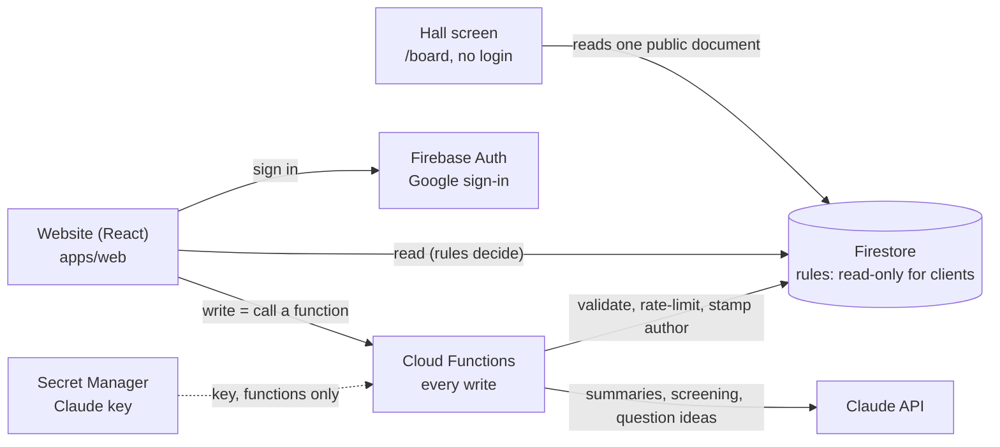
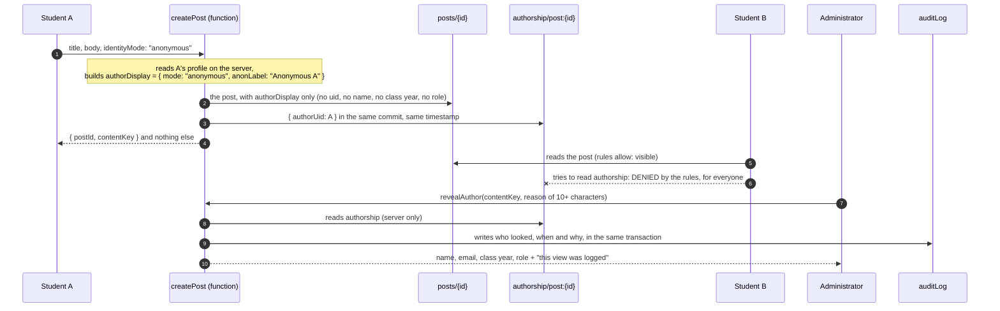

# How Nobles Commons fits together

This is written for a student who wants to understand the system and a school administrator who wants to know where the guarantees come from.

## The pieces



Three rules make the rest simple:

1. **The website can only read.** `firestore.rules` denies every write from every client, including administrators. All 39 rules tests assert this.
2. **Every write is a Cloud Function.** Each one checks, in this order: signed in, verified email, allowed domain, onboarded with a current role, payload size, input shape (zod), rate limit. That list lives in one place, `functions/src/guard.ts`.
3. **Functions return only safe fields.** No function ever returns a uid, and error messages are plain sentences that never mention one.

## The anonymity flow



What this buys:

- **Nothing about the author is on the post.** `authorDisplay` for an anonymous post is `{ mode, anonLabel }` and nothing else. A faculty member posting anonymously has no faculty tag either.
- **The record of who wrote it exists once**, in `authorship`, which no client can read: not students, not moderators, not administrators. The rules tests prove each of those separately.
- **The only way to it is `revealAuthor`**, which needs the admin role, needs a reason, and writes the audit entry in the same transaction that reads the author. If the log cannot be written, nothing is revealed.
- **Ids and timestamps give nothing away.** Post and comment ids are random Firestore ids. The authorship record carries the same timestamp as the content, no finer.
- **Letters are per thread.** `threadAnon/{postId}/members/{uid}` gives each anonymous author one letter in that thread ("Anonymous B"), so a conversation can be followed. In another thread the letters start again, so two threads cannot be linked. That collection is also closed to every client.
- **Search never indexes authors.** `searchTokens` is built from the title, the start of the body and the space name.
- **Moderators work blind.** The moderation queue stores a snapshot of the text and nothing about who wrote it. Moderators cannot read `users` either.

The tests that hold this in place are `tests/rules/firestore.rules.test.ts`, `tests/functions/anonymity.test.ts` and the "another student sees the anonymous thread" step in `e2e/flow.spec.ts`.

### What it does not buy

Anonymous here means "hidden from other students", never "hidden from the school". In a small community people can sometimes guess an author from how something is written. Screenshots exist. `docs/SAFETY.md` and the About page say so.

## Data model

All ids are Firestore auto ids. All timestamps are server timestamps. Types live in `packages/shared/src/types.ts`.

| Collection | Holds | Who can read from a client |
| --- | --- | --- |
| `users/{uid}` | Private profile: email, display name, class year, role | The owner and administrators |
| `spaces/{id}` | Name, slug, description, who can post, thread count | Members |
| `posts/{id}` | A thread. `authorDisplay`, counts, hot score, status, optional poll, link and summary | Members, when `status == 'visible'`. Moderators see all |
| `posts/{id}/comments/{id}` | A comment: parent, depth, body, `authorDisplay`, status | Same as posts |
| `authorship/{contentKey}` | Who wrote a post or comment | **Nobody** |
| `threadAnon/{postId}/members/{uid}` | Which anonymous letter a person has in a thread | **Nobody** |
| `votes/...`, `pollVotes/...` | One "Thoughtful" or poll vote per person per item | Only the person who cast it |
| `reports/{id}` | A report: content, reason, note, reporter | Moderators and administrators |
| `moderationQueue/{id}` | Things waiting for a moderator: reason, labels, a text snapshot | Moderators and administrators |
| `auditLog/{id}` | Every moderation action, role change and author lookup. Append-only | Administrators |
| `dailyQuestions/{id}` | Proposed questions of the day | Moderators and administrators |
| `config/*` | Roles by email, banned AI topics, calendar notes, wellbeing resources, the board question | Administrators |
| `boardFeed/current` | A sanitised snapshot for the hall screen. No uid, no authorship | **Public** (the TV has no login) |
| `usage/{date}`, `rateLimits/{uid}`, `mail/*`, `archive/*` | AI token ledger, rate-limit buckets, outgoing wellbeing email, old removed content | Nobody |

## What happens when someone posts

1. The composer makes the person choose "Post as": their name or Anonymous. Nothing is preselected, and the notice about what the administration can see is shown every time.
2. `createPost` validates, takes a rate-limit token, and writes the post as `status: 'held'`, `screening: 'pending'`, together with the authorship record.
3. The `screenContent` trigger asks the model to classify the text (see `docs/AI.md`):
   - nothing worrying: the post becomes `visible`;
   - harassment, hate, sexual content or personal information: it stays held and goes to the moderation queue;
   - self-harm or harm to others: it is **never deleted and never published**. It stays held, goes to the top of the queue marked "wellbeing", the school's wellbeing contact is emailed, and the author sees a caring message with resources.
4. The website waits a few seconds for that result (`getMyContentStatus`) and then shows the thread, a "a moderator will take a look" note, or the caring message.
5. If the model is unavailable, a small phrase check still catches the clearest safety signals and everything else is published. Reports and moderators remain.

## Feed ranking

`packages/shared/src/hot.ts`:

```
score = thoughtfulCount + 0.5 * commentCount
hot   = log10(max(score, 1)) + (createdAtSeconds - 1767225600) / 45000
```

Pinned threads sort first in every sort order. The sorts are Hot, New, Top this week and No replies, 20 posts a page with a cursor. The website asks for the next page when the reader nears the bottom and writes the page count into the address (`?page=3`), so a refresh reloads the same pages; it stops at the last post. Counts are updated in the same transaction as a vote and then recounted from the source by a trigger, so they repair themselves.

## The hall screen

`/board` is its own small bundle with no sign-in code. It listens to one document, `boardFeed/current`, which the functions rebuild whenever the question, its poll or an approved reply changes. Only replies a moderator approved for the screen are in it. The QR code is generated at build time from `PUBLIC_URL`.

## Security checklist and where each item lives

| Item | Where |
| --- | --- |
| Default-deny rules, no client writes | `firestore.rules`, `storage.rules` |
| Auth, verified email, domain, role, payload size, zod, rate limit on every callable | `functions/src/guard.ts` |
| Generic errors without uids | `functions/src/errors.ts` |
| Security headers and a strict Content-Security-Policy with no inline scripts | `firebase.json` (the e2e tests run under the same headers) |
| User text is never HTML | `packages/shared/src/safeText.ts`, `apps/web/src/components/SafeText.tsx`, an ESLint rule that bans `dangerouslySetInnerHTML` |
| User text is fenced and neutralised before it reaches a model | `functions/src/ai/prompts.ts` |
| Model output is validated and never trusted | `functions/src/ai/provider.ts` |
| Secrets never in git or the bundle | `scripts/check-secrets.sh`, run in CI |
| Links are stored, never fetched by the server | `functions/src/content.ts` |
| Data retention | `functions/src/scheduled.ts` (`archiveOldContent`) |
| Account export and deletion | `functions/src/users.ts` |
